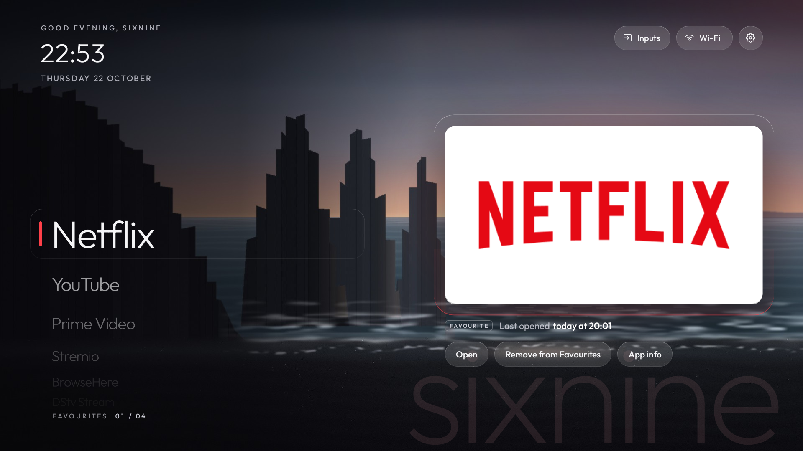
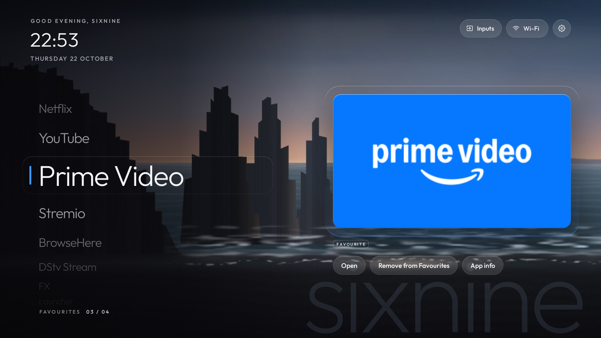
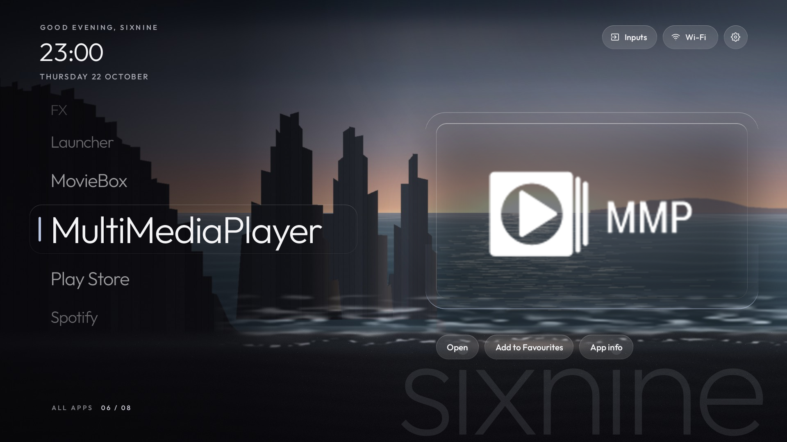
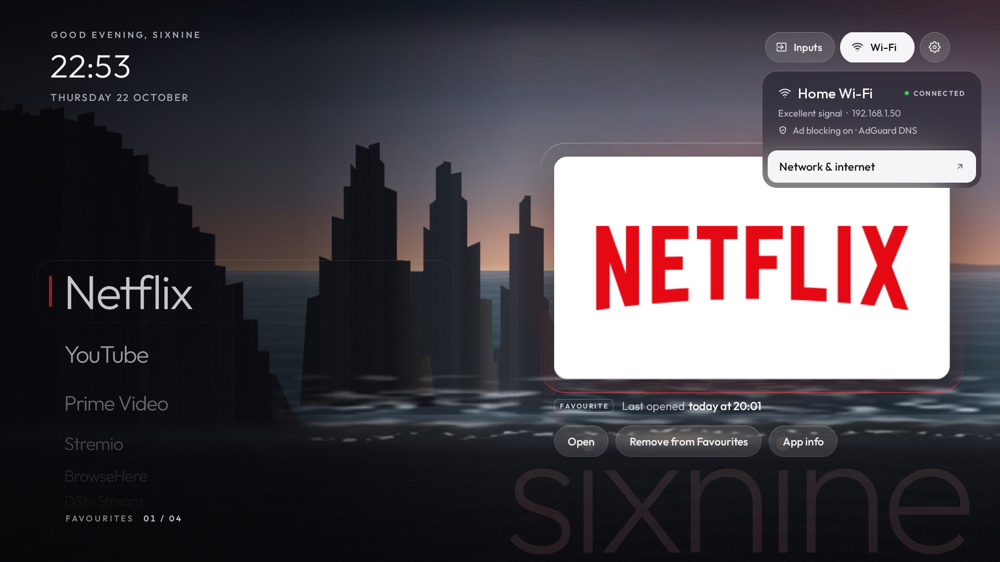
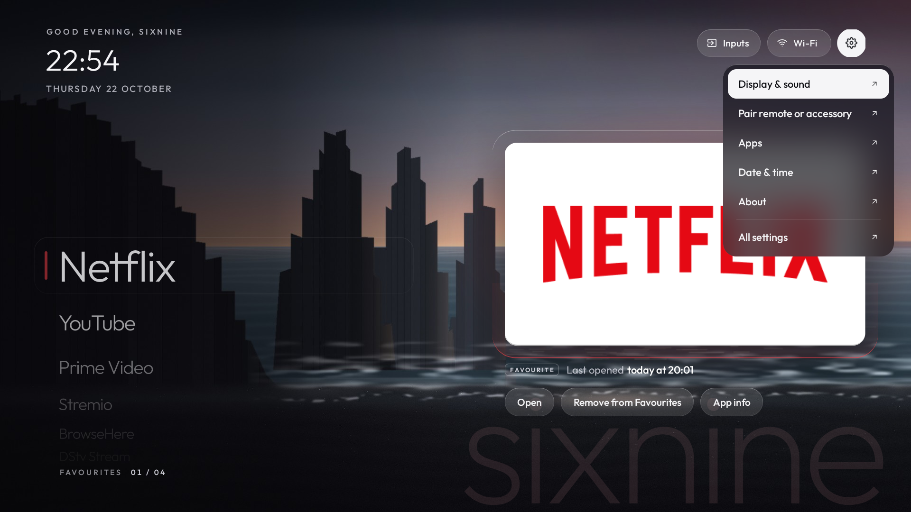

# Spotlight

An Apple TV–style home screen for Android TV, made for a TV with 1.4 GB of RAM.

- **App names on a turning wheel** down the left, over a black sand beach.
- **The focused app's card** sits in a glass slab on the right, with Open, Favourites and App info
  underneath.
- **Glass menus** for All apps, Inputs, Wi-Fi and Settings.
- **It greets you by name** and signs it faintly across the corner.

Built with [CleanYourTV](https://github.com/Gathin23/cleanyourtv)'s prompt and tools, as a launcher
of its own.



| | |
|---|---|
|  |  |
|  |  |

## What it does

- **The list:** favourites first, in your order, then everything else by name. Up and Down turn
  the wheel; the card, its colour and "Last opened" follow.
- **The colour:** the focused app's colour lights the top-right corner, the glow behind the card,
  the card's rim and the marker on the list. It is sampled from the app's own banner.
- **OK opens the app**, which grows out of its card. **Hold OK** (or press Menu, or Right) for
  the actions: Open, Add to or Remove from Favourites, App info.
- **All apps** lists every app on the TV, the ones not on Home first. OK puts an app on Home or
  takes it off, without closing the list.
- **Inputs** lists HDMI 1–4, AV and Live TV. Ports with nothing plugged in are greyed out.
- **Wi-Fi** shows the network, signal, the TV's address and whether a private DNS (ad blocking)
  is on, and opens the TV's network settings.
- **Settings** opens Display & sound, pairing, Apps, Date & time, About and the rest of the
  TV's own Settings. Only screens the TV actually has are listed.
- **With a menu open,** Left and Right move to the next pill's menu, like a menu bar.
- **Live TV at power-on:** some TVs, UK Freeview Play sets among them, open Live TV every time
  they're switched on. With `BOOT_TO_HOME=on`, Spotlight starts with the TV and comes straight
  back. Live TV shows for 2–4 seconds instead of about 17.

## Built and tested on

JVC "UK 4K Android TV" (MTC MSD6886, `sadang`, MediaTek), Android TV 11, 1.4 GB RAM. Measured
there with `tools/perf.sh` (26 remote presses), against CleanYourTV's launcher on the same TV:

| | Spotlight | CleanYourTV |
|---|---|---|
| Janky frames | 0.73% | 0.83% |
| Frame time, 99th percentile | 16 ms | 15 ms |
| Memory (PSS), idle | 36 MB | 31 MB |

**How it stays light:**
- No blur, no video and no background work: it's quiet once things settle.
- Names are drawn once and the wheel moves pictures of them, rather than redrawing text every frame.
- The menus' frosted glass is one snapshot taken when a menu opens.

## Privacy

- **No internet permission.** Nothing leaves the TV.
- **What it reads:** the installed apps, the Wi-Fi state, and usage stats (only if they're granted
  at install). Usage stats feed "Last opened" and the Live TV check at power-on.
- **Location:** granted at install only so Android shows the Wi-Fi name. Without it the pill just
  says Wi-Fi.

## Install

**With an assistant:** paste [`PROMPT.md`](PROMPT.md) into Claude Code or another coding
assistant with shell access. It:
- debloats the TV with CleanYourTV's prompt;
- asks your name, favourites, background and whether the TV opens Live TV at power-on;
- installs Spotlight and checks it with screenshots.

**By hand:**
1. On the TV, turn on Developer options → USB debugging.
2. Install a JDK (17 or newer) and the Android SDK.
3. Set up Python: `python3 -m venv .venv && .venv/bin/pip install -r tools/requirements.txt`.
4. Run:

```sh
TV_HOST=192.168.1.50 NAME=Ada FAVOURITES=com.netflix.ninja,com.google.android.youtube.tv tools/install.sh
```

The script:
- builds Spotlight;
- grants what it needs over ADB;
- makes it Home and checks that Home really switched.

| Option | What it does |
|---|---|
| `NAME=Ada` | "Good evening, Ada", and "Ada" signed faintly in the corner. `NAME=none` shows neither |
| `FAVOURITES=pkg,pkg` | The apps at the top of the list, in order |
| `PHOTO=~/beach.jpg` | Your own background instead of the painted beach. Any size; it's cropped to 16:9 and the left side darkened for the list |
| `BOOT_TO_HOME=on` | Come straight back when the TV opens Live TV at power-on |

When you're done, switch USB debugging off: an open ADB port on your network is a risk.

## Change settings later

You don't need to rebuild. With debugging on:

```sh
TV_HOST=192.168.1.50 .venv/bin/python tools/tv.py 'am broadcast -n io.github.iyiolajay.spotlight/.ConfigReceiver -a io.github.iyiolajay.spotlight.CONFIG --es name Ada'
```

- **`--es name Ada`** changes the name; `none` removes it.
- **`--es favourites pkg,pkg`** sets the favourites, in order.
- **`--es hidden pkg,pkg`** sets which apps start off Home.
- **`--es boot_to_home on`** turns on the Live TV check at power-on (`off` turns it off).
- **`default`** for any of them goes back to [`config.xml`](launcher/app/src/main/res/values/config.xml).

A new background needs a rebuild: `PHOTO=~/new.jpg tools/install.sh`.

## If Home doesn't switch

A stock launcher can outrank Spotlight even after `set-home-activity` says "Success". On the JVC
it had a higher priority, and only disabling it handed Home over. CleanYourTV's prompt covers
doing that safely:
- Google TV's setup wizard can take Home back.
- CVTE boards must keep their own launcher.

## Remove it

```sh
TV_HOST=192.168.1.50 tools/uninstall.sh com.google.android.tvlauncher/.MainActivity
```

Name the launcher to give Home back to. The script re-enables it first if you had disabled it.

## Credits and licence

- **Licence:** MIT ([`LICENSE`](LICENSE)). `tools/tv.py` and `tools/adb-closed.py` are adapted from
  CleanYourTV's, under its MIT licence
  ([`tools/CLEANYOURTV-LICENSE.txt`](tools/CLEANYOURTV-LICENSE.txt)).
- **Typeface:** [Outfit](https://github.com/Outfitio/Outfit-Fonts), SIL Open Font License
  ([`launcher/OUTFIT-OFL.txt`](launcher/OUTFIT-OFL.txt)).
- **The black sand beach** is painted in code by [`tools/make-blacksand.py`](tools/make-blacksand.py).
- **Thanks** to [Gathin23](https://github.com/Gathin23) and the CleanYourTV contributors: the
  debloat method, the prompt and the "build it small" rules all come from there.
